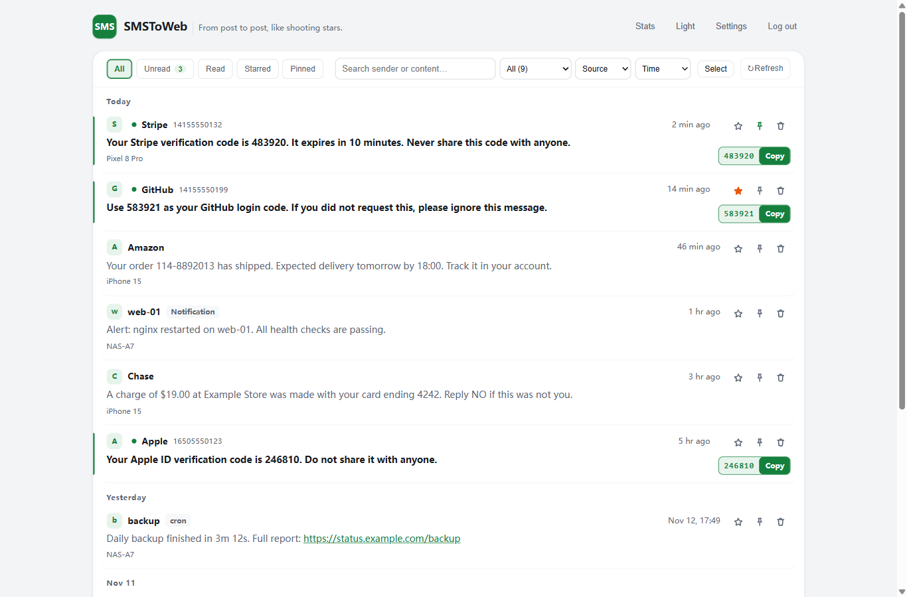
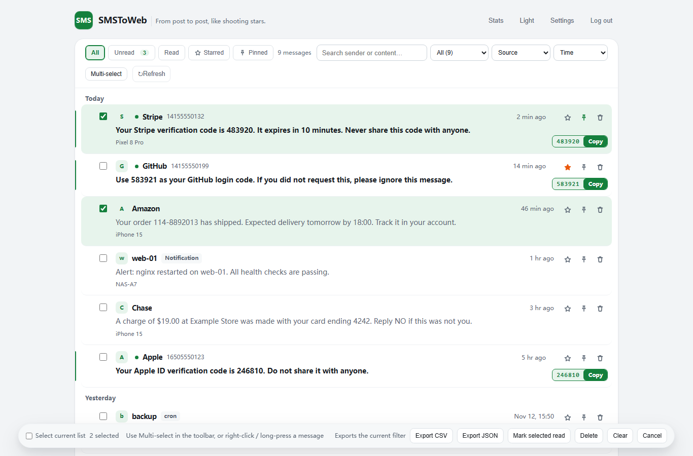
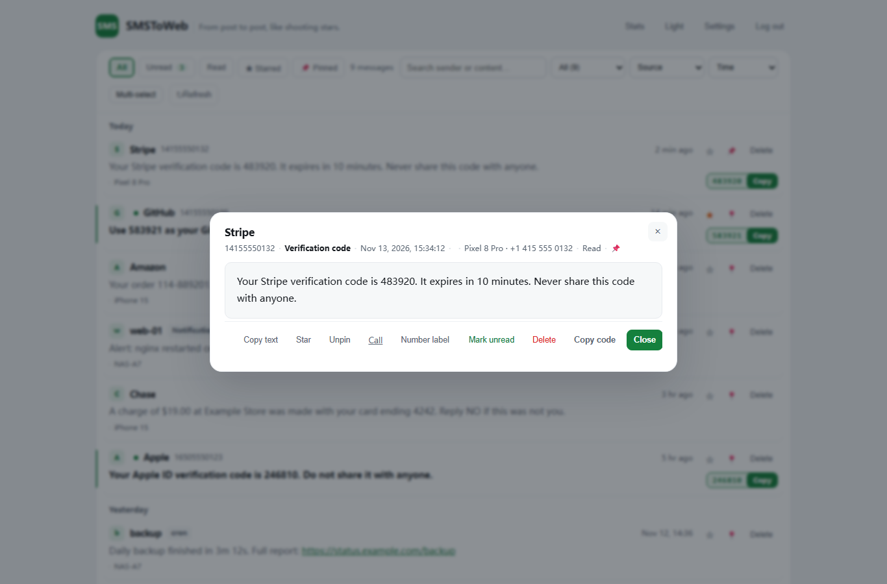
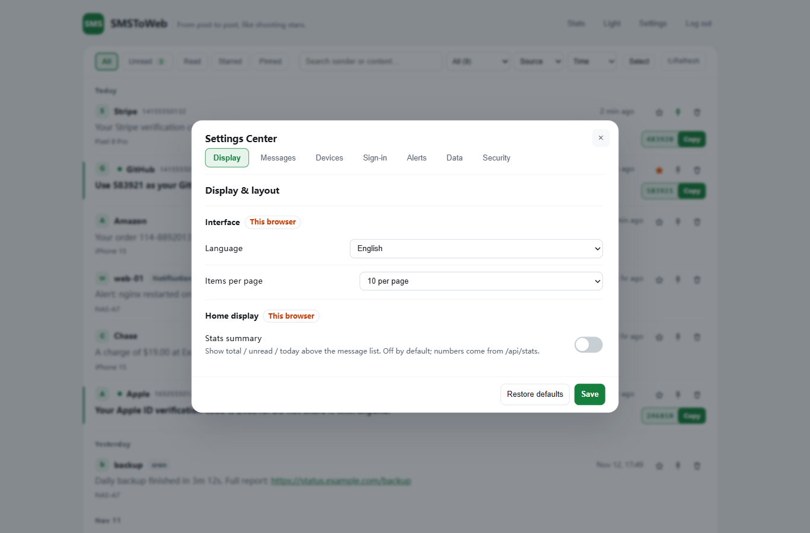
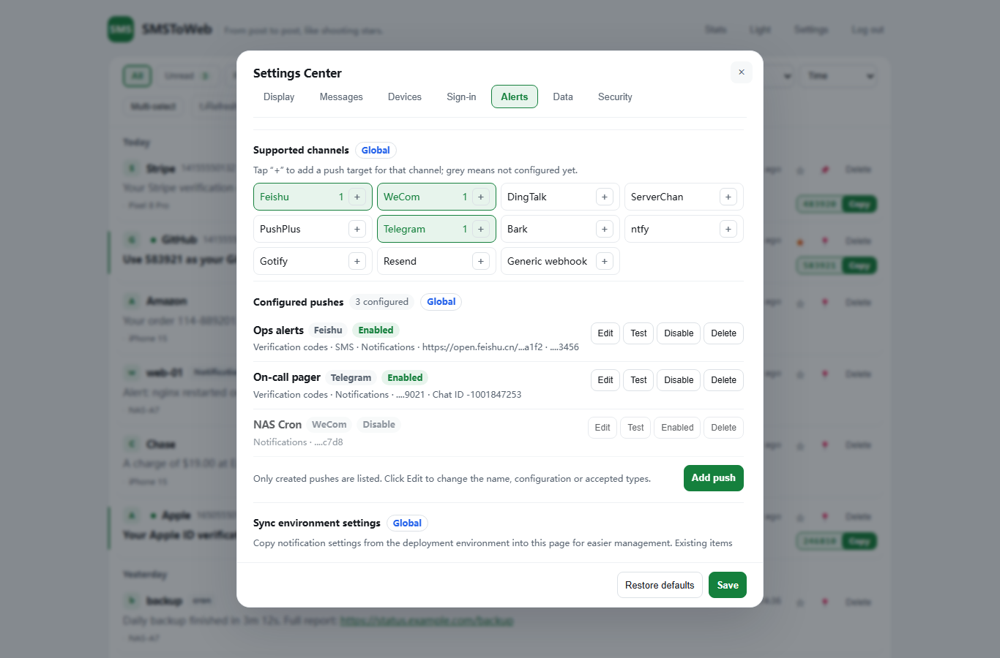
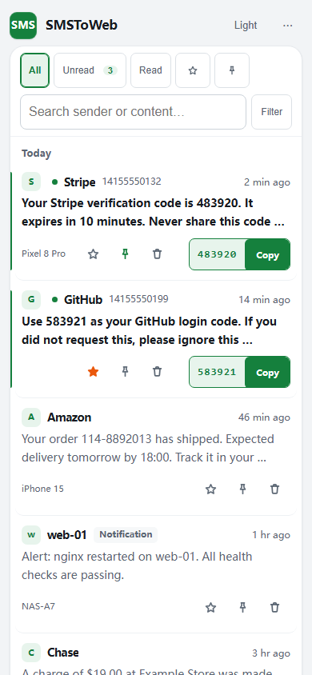

# SMSToWeb — SMS & Notification Cloud Gateway

**English** | [简体中文](docs/i18n/zh-CN/README.md) | [繁體中文](docs/i18n/zh-TW/README.md) | [日本語](docs/i18n/ja/README.md) | [한국어](docs/i18n/ko/README.md) | [Español](docs/i18n/es/README.md) | [Français](docs/i18n/fr/README.md) | [Deutsch](docs/i18n/de/README.md) | [Português (BR)](docs/i18n/pt-BR/README.md)

> English is the primary maintained version of this document. Translations live under [`docs/i18n/<lang>/`](docs/i18n/README.md) and may lag behind; when in doubt, refer to this file.

**New here / 第一次使用？** → [Quick start (English)](docs/i18n/en/QUICKSTART.md) · [完整中文用户指南](docs/guide/README.md) · [常见问题](docs/guide/05-常见问题.md). You do **not** need to read the source code, the API reference, or this whole page to get started: the guide tells you which button to click, what to fill in, and how to confirm it worked.

Forward SMS from an Android phone and notifications from any HTTP-capable device to the cloud in real time, and read them from a web page anywhere.

**Current version: `v1.1.0`** — official releases carry a fixed version number (shown in the page footer); interim builds bump the patch version.

- **Multi-platform deployment**: Cloudflare (primary) / Vercel / Deno Deploy / Netlify / Tencent EdgeOne Makers / Docker self-hosted — pick one of six, features fully identical
- **Real-time receiving**: webhook push lands in the database in seconds; the web page refreshes itself, no manual work
- **Universal push**: any device that can send an HTTP request (Linux / Windows / macOS / iOS / NAS / scripts) can push notifications into the same page
- **Sources & filters**: filter dynamically by source (SMS / notifications and custom sources auto-aggregated), stacked with keyword search and Today / Last 7 days / Last 30 days ranges; adjustable page size
- **Message list**: **10 messages per page by default**; each card shows a **two-line summary (up to 120 codepoints, Unicode-safe)** and opens the full text in a detail dialog; a **Load more** button appends older messages progressively (cursor pagination, no full-history fetch); opening a message marks it read (failure rolls back and reports instead of faking success)
- **Verification code**: codes are detected server-side (Chinese / English / mixed, 4–8 digits, separator and alphanumeric forms, phone/order/amount/date noise stripped) and shown in the card header with a one-tap copy button; copy uses the Clipboard API with an `execCommand` fallback and reports failure instead of faking success
- **Pagination consistency**: the cursor carries a **SHA-256 fingerprint of the starred ID set**; if starring changes mid-session, the server rejects the stale cursor with `409 CURSOR_STALE` and the page reloads from the top, so messages are never skipped or duplicated (starred-pinned ordering is unchanged)
- **Multi-channel forwarding**: new messages can be auto-forwarded to Feishu / WeCom / DingTalk / Telegram / ServerChan / PushPlus / Bark / ntfy / Gotify / Email / generic Webhook — configured in the admin **Settings → Notifications** page (stored in your database, per-channel enable/disable, **multiple independent targets per channel**, credential update, per-target test send); one failing target does not block the others, and legacy environment variables are still honoured when no database value exists
- **Optional security**: admin login toggle, multi-format OTP code extraction (code-first / keyword-first / segmented / mixed, false-positive resistant) with one-tap copy, dark mode
- **Data & alerts**: export CSV / JSON by current filter; toast / optional sound / floating pill for new messages while visible, browser notification + unread title while hidden; long messages show a short summary and open the full text in a detail dialog
- **Number recognition**: built-in directory of common institutional numbers (carriers / banks / couriers / government) auto-labeled; optional carrier-region lookup for unknown mobile numbers (on by default, can be disabled)
- **9 languages**: the admin and login pages ship with zh-CN / zh-TW / en / ja / ko / es / fr / de / pt-BR built in; switch from **Settings → 界面语言** on the admin page (browser-scoped, `?lang=` deep link supported, choice remembered locally); dates, relative times and directory labels switch along
- **Mobile friendly**: `viewport-fit` safe-area support for notches and gesture bars, 16px inputs to prevent iOS auto-zoom, larger touch targets, bottom-sheet dialogs, PWA add-to-home-screen
- **Bulk & undo**: checkboxes and the bulk bar stay hidden until you right-click / long-press a message; batch mark-read, delete, clear-by-filter and CSV/JSON export for the current filter; 5-second undo after deletion (soft delete); dark mode with auto / light / dark
- **Starred / unread / stats**: star to pin, starred-only / unread-only views, stats panel (source breakdown + last 7 days); custom number labels; search highlight and history; do-not-disturb and sound in settings; PWA

## Screenshots

**Message center overview** — a 1180px dashboard: the message list on the left and a real-data sidebar (devices with last-received time, settings overview, quick stats) on the right. Filters and search stay in one compact toolbar; page size, quiet hours and language live in Settings instead of the header.



**Multi-select on demand** — checkboxes and the bulk bar are hidden by default. Right-click any message (or long-press on touch devices) to enter selection mode; the inline bar then offers select-all, mark read, delete, clear-by-filter, and CSV/JSON export for the current filter.



**Message detail** — a single line of metadata (number · type · time · device · status, plus ★ only when starred) and one action row: copy / star / call / label / delete on the left, close / toggle read on the right. No message ID, no redundant information grid.



**Settings center** — four groups (sign-in & session / notifications / data & operations / security). Language, page size, message toggles and quiet hours are browser-scoped and saved with the same Save / Cancel / Reset flow; credentials are masked and never echoed.



**Notification multi-target** — each channel can fan out to several targets (e.g. two Feishu groups). Targets can be enabled, renamed, deleted and tested individually; one failing target does not block the others.



**Mobile layout** — the sidebar collapses below the list, dialogs become bottom sheets, and the hidden-by-default bulk bar still fits on a 390px viewport without horizontal overflow.



```
[SMS] Android(SmsForwarder) ──POST /api/receive──┐
                                                 ├─→ cloud gateway (any platform) ─→ database
[notify] scripts / shortcuts ──POST /api/push────┘        │
                                                browser ◀── web admin (embedded in gateway)
```

**Deploy to Cloudflare (recommended for beginners):**

[](https://deploy.workers.cloudflare.com/?url=https://github.com/ShenDoyle/SMSToWeb/tree/main/platforms/cloudflare)

What this button **actually** does (Cloudflare "Deploy to Cloudflare" flow): clones the public repository into **your own** GitHub/GitLab account, creates and binds the **D1 database** (and other Cloudflare-native resources declared in `wrangler.toml`), and sets up a build/CI so later pushes redeploy. It does **not** run SQL migrations, does **not** create a Turso database, and does **not** fill in your secrets — you still type `RECEIVE_TOKEN` (and `ADMIN_PASSWORD` / `SESSION_SECRET` if you enable login) on the setup page. Creating the tables is handled by the application itself: `ensureSchema` runs on the first request and creates missing tables / columns / indexes automatically (see [UPGRADE](docs/UPGRADE.md)). Honest summary: **one click to create the app + a few fields to fill in**, not "one click and you are live". For the exact click-by-click path see [Cloudflare 部署指南](docs/guide/03-平台部署/01-Cloudflare.md).

> **Version caveat (important):** this button deploys the **`main` branch of the public GitHub repository**, which can lag behind this local working tree. The source version in this checkout is `v1.1.0` (RC2 release candidate) — the v1.0.4-era fixes are now part of it; the release `v1.1.0` has **not** yet been formally published (RC2 is a release-candidate review, not the final release). Do not assume the button deploys the fixes described here.

> **Buttons on other platforms:** Cloudflare / Vercel / Netlify already have buttons in their platform guides; Deno Deploy and EdgeOne have official buttons too, but this project has **not** validated them and does not ship them; Node/Docker self-hosting has **no** one-click deploy at all. See the [verified deployment capability matrix](docs/guide/10-部署能力矩阵.md).

| Platform | Deployment | Scheduled cleanup | Guide |
|---|---|---|---|
| **Cloudflare** (recommended) | Worker + D1 | platform cron | [platforms/cloudflare/README.md](platforms/cloudflare/README.md) |
| Vercel | Edge Function + Turso | platform cron | [platforms/vercel/README.md](platforms/vercel/README.md) |
| Deno Deploy | Deno native + Turso | Deno.cron | [platforms/deno/README.md](platforms/deno/README.md) |
| Netlify | Functions v2 + Turso | Scheduled Function | [platforms/netlify/README.md](platforms/netlify/README.md) |
| Tencent EdgeOne Makers | Functions + Turso | external cron | [platforms/edgeone/README.md](platforms/edgeone/README.md) |
| Fly.io / Railway / VPS | Docker (Node 22) + Turso / local SQLite | in-process | [platforms/node/README.md](platforms/node/README.md) |

> Every platform directory is **fully self-contained** (code + schema + standalone docs, zero npm dependencies, no build step). Click a guide above and follow the steps. Features and the data schema are identical across platforms; you can migrate between them at any time.
> For platform comparison and common preparation (Turso database), see [platforms/README.md](platforms/README.md).

### Runtime differences (read before deploying)

Business code is byte-identical across the six platforms, but **timeouts / background tasks / timers** differ at runtime. Adapt via environment variables when needed:

| Platform | Function timeout | How notification forwarding is scheduled | Scheduled cleanup | Suggestion |
|---|---|---|---|---|
| Cloudflare | no wall-clock limit (CPU-limited) | native `ctx.waitUntil` (30s cap after the response) | platform cron | defaults work |
| Vercel Edge | plan-dependent | entry probes `context.waitUntil`; if unavailable, falls back to inline `await` | platform cron | entry default `WAIT_MAX_SECONDS=20` |
| Netlify Functions | plan-dependent | entry probes `context.waitUntil` (only for functions deployed on/after 2025-03-20); otherwise inline `await` | scheduled function | entry default `WAIT_MAX_SECONDS=8` |
| Deno Deploy | plan-dependent | entry probes `EdgeRuntime.waitUntil`; the official Runtime docs do not document it, so inline `await` is the common path | needs external trigger | external cron calling `/api/cron?token=` |
| EdgeOne Makers | plan-dependent (CPU 200ms excl. I/O) | `onRequest(context)` passes native `context.waitUntil`; falls back if missing | needs external trigger | entry default `WAIT_MAX_SECONDS=20` |
| Node / Docker | your choice | project's own `bgCtx.waitUntil`; background tasks are **registered and awaited during shutdown** (M-1) | in-process timer + `/api/cron` | local SQLite needs Node ≥ 22.13; **container stop grace must be ≥ 90s** |

> - **All six platform entries pass a `ctx`-style object to `fetchApp`.** What differs is whether the *runtime* actually provides `waitUntil`: `bgRun` uses it when present (forwarding continues after the response) and degrades to an inline `await` when absent (the response then waits for forwarding). An older revision of this README claimed the other five platforms "always finish notifications before the response" — that is wrong; see [ARCHITECTURE §4](docs/ARCHITECTURE.md).
> - **Long polling**: the frontend retries failures with **exponential backoff** (2→30s) and re-polls immediately when the page becomes visible; platform-killed requests never flood the function. The per-channel fetch timeout is 10s. `WAIT_MAX_SECONDS` is clamped to 3–25 by the core and lowered by some entries (Vercel 20 / Netlify 8 / EdgeOne 20) as a default, overridable by env var.
> - **Scheduled cleanup**: on platforms without cron, point any scheduler at `GET /api/cron?token=<RECEIVE_TOKEN>`.
> - **Node shutdown (M-1)**: HTTP in-flight budget 30s + background drain 45s + 5s margin = **80s** app grace (`SHUTDOWN_GRACE_MS`; floor 80s, ceiling 120s). SQLite is closed only after background tasks finish or time out. The **container** must allow ≥ 90s or Docker/systemd will SIGKILL the process first — see [停止宽限与部署配置](docs/guide/07-停止宽限与部署配置.md). Verified on local WSL2 Docker, **not** in production.

---

## Phone Setup & Multi-device Ingestion

All platforms deliver messages into the same web page: phone SMS goes through `/api/receive` (Android SmsForwarder), everything else uses the universal `/api/push`.

Step-by-step configuration (copy-paste commands/scripts per platform): **[Deployment & Ingestion Guide](docs/i18n/en/DEPLOYMENT.md)**

Android background-survival settings (battery optimisation, autostart, vendor restrictions, lock-screen/reboot checks, per-model guidance): **[Android SmsForwarder Keep-Alive Guide](docs/安卓SF保活指南.md)** (Chinese; ask the AI assistant with your exact phone model for a tailored path).

**Universal push quick reference** (full fields in the guide):

```
POST https://<your-domain>/api/push?token=<RECEIVE_TOKEN>
{"source":"notify","sender":"demo","content":"hello from anywhere"}
```

A `{"success":true,...}` response means it is stored; pushing the exact same payload again returns `duplicated:true`.

## Environment Variables (all platforms)

| Variable | Required | Description |
|---|---|---|
| `RECEIVE_TOKEN` | yes | push auth secret; pick a long random string. Works as the **fallback** ingest credential: named tokens created in the admin page take priority |
| `DISABLE_RECEIVE_TOKEN` | no | set `"true"` (case/whitespace-insensitive) to **disable the `RECEIVE_TOKEN` fallback** so only hashed named tokens can push; unset = fallback enabled (migration-friendly default). Does not affect `/api/cron`, which always uses the env var. **Fixed in v1.1.0 (P1):** this key is now part of the 32→33-entry `ENV_KEYS` whitelist and every ported entry's `buildEnv()` passes it through, so disabling the `RECEIVE_TOKEN` fallback takes effect on **all six platforms** (Cloudflare / Vercel / Netlify / Deno / EdgeOne / Node) — not just Cloudflare. Default (unset) keeps the fallback enabled; only the string `"true"` (case/whitespace-insensitive) disables it. |
| `ENABLE_AUTH` | no | `"true"` requires login for the admin page (**strongly recommended**, see security notes below); default is no login |
| `ADMIN_PASSWORD` | no | login password (set when `ENABLE_AUTH="true"`; if missing, admin APIs refuse access and log an alert — missing config never opens the door) |
| `RETENTION_DAYS` | no | data retention in days, default 30. Editable in **Settings → 设置中心 → 数据与业务** (the database value wins; this variable is only the fallback when no database value exists) |
| `WAIT_MAX_SECONDS` | no | max seconds `/api/wait` long polling may hang; the core clamps to **3–25** and defaults to **25**. Some entries ship safer defaults (Vercel `20`, Netlify `8`, EdgeOne `20`); an explicit env value always wins. Check your platform's *own* function-duration limit and lower it if requests are killed — older revisions of this README quoted conflicting platform numbers (10s / 60s); do not rely on them, verify against the platform's current documentation |
| `PHONE_AREA_ENABLED` / `PHONE_AREA_API` | no | legacy fallback for carrier-region lookup: on by default (free 360 API, no key, 24h backend cache, 11-digit mobile numbers only); set `false` to disable; custom source via `PHONE_AREA_API` (URL with `{number}` placeholder). Prefer **Settings → 设置中心 → 数据与业务**, which stores the same values in the database and takes precedence |
| Notification channel variables | no | **Legacy fallback only.** Configure channels in **Settings → 设置中心 → 通知** (database-backed, with per-channel enable/disable, credential update, masked display and a test-send button). These variables still work when the corresponding database key does not exist, which keeps existing deployments running after an upgrade: `FEISHU_WEBHOOK` (Feishu) / `WECOM_WEBHOOK` (WeCom) / `DINGTALK_WEBHOOK` (DingTalk, optional `DINGTALK_SECRET` signing) / `SERVERCHAN_SENDKEY` / `PUSHPLUS_TOKEN` / `TELEGRAM_BOT_TOKEN`+`TELEGRAM_CHAT_ID` / `BARK_DEVICE_KEY` (optional `BARK_URL`) / `NTFY_URL` (optional `NTFY_TOKEN`) / `GOTIFY_URL`+`GOTIFY_TOKEN` / `RESEND_API_KEY`+`MAIL_TO` (email, optional `MAIL_FROM`) / `GENERIC_WEBHOOKS` (generic webhook, optional `GENERIC_WEBHOOK_TEMPLATE` body / `GENERIC_WEBHOOK_HEADERS` headers). With nothing configured nothing is forwarded. Notifications auto-render in three modes by content (🔐 OTP / 💬 SMS / 🔔 notification) |
| `SITE_NAME` / `SITE_ICON` | no | site name / icon URL; defaults apply when unset |
| `NOTIFY_LINK` | no | legacy fallback for the admin page home URL; when set, every notification channel gets an "Open admin" entry (button/link/click). Editable in **Settings → 设置中心 → 通知** (database value wins; leaving the field empty there is an explicit clear that also hides this variable) |
| `SESSION_SECRET` | required when login is on | session signing secret: **high-entropy random value (≥32 random characters recommended), fully independent from the admin password**; Cloudflare and EdgeOne (and every other platform) must each have their own value; never commit it to Git or reuse the password. If missing, login and auth **fail closed** (login returns 500, admin APIs return 401, no password-derived fallback). Rotating the value invalidates all existing sessions immediately. Sessions last 30 minutes; logout only clears the browser cookie — a copied session token remains valid within its TTL (up to 30 minutes) |
| `SHUTDOWN_GRACE_MS` | no (Node self-hosting only) | overall **application** shutdown grace in milliseconds. It is derived, not fixed: `HTTP 30s + background drain 45s + 5s = 80000`. You may raise it (ceiling `120000`), but a value below the derived `80000` is ignored. This is **not** the container/systemd stop grace — that one is set by the deployer and must be ≥ 90s (see below) |

Cloudflare additionally needs the `DB` (D1 binding); other platforms need `TURSO_DATABASE_URL` / `TURSO_AUTH_TOKEN` (Turso database, see each platform guide); Node self-hosting also supports `SQLITE_PATH` local SQLite mode (see platforms/node/README.md).

> **Node self-hosting — stop grace (M-1 / M-3):** the application waits for in-flight HTTP requests and registered background notification tasks before closing SQLite, with an 80s overall budget. If the container or service manager kills the process earlier, that wait never happens. Docker's default stop grace is **10s**, which is far too short. Set **one** of these, matching how you deploy — do not set all four: `docker run --stop-timeout=90`, `docker stop --timeout 90 <container>`, Compose `stop_grace_period: 90s`, or systemd `TimeoutStopSec=90s`. The `Dockerfile` comment cannot set this for you; the deployer must. See [停止宽限与部署配置](docs/guide/07-停止宽限与部署配置.md) for copy-paste templates and the distinction between local verification and production configuration.

> **Security recommendations**
> 1. **Turn on admin login** (`ENABLE_AUTH="true"` + `ADMIN_PASSWORD`): the admin page holds sensitive content such as SMS OTP codes; without login, anyone who knows the domain can read every message and delete data. The login endpoint is rate-limited (5 consecutive failures per IP locks it for 10 minutes); `/api/receive` and `/api/push` are rate-limited to 120 writes per IP per minute (429 beyond that).
> 2. **Token in URLs — recommended: header, query for compatibility only**: `/api/receive` and `/api/push` accept the token via (in priority order) the `X-Receive-Token` header → `?token=` query → `Authorization: Bearer` → `token` in the JSON body. **The `X-Receive-Token` header is the recommended way** (never lands in access logs, browser history or referrers); the `?token=` query exists only for compatibility with SmsForwarder-style clients. You can create named tokens in the admin page (Settings → 接入令牌 / Access tokens), where they are stored hashed (SHA-256) and can be revoked or rotated per device instantly; each token can carry a **note** (to tell devices apart) and an **expiry** (permanent / preset days / custom date — expired tokens are rejected with 403 automatically, without losing the audit row); the deploy-time `RECEIVE_TOKEN` env var keeps working as a fallback until you set `DISABLE_RECEIVE_TOKEN="true"`.
> 3. **Notification credentials are stored as plaintext** in your own `settings` table (v1.0.3 does **not** implement encryption at rest): whoever can read the database — including a backup, snapshot or copied SQLite file — can read the Webhook URLs and tokens. Protect database access and backups accordingly; the admin API only returns "configured + last-4 mask" and logs redact URLs.

## Settings Page (admin)

Open the admin page → **Settings** (齿轮 / 设置). Everything below requires a login session when `ENABLE_AUTH="true"`.

| Group | What you can do | Scope / Stored in |
|---|---|---|
| 登录与会话 (Sign-in & session) | **Sign-in validity (this browser)**: 5–43200 minutes for **new sign-ins in this browser only** (localStorage, sent with each login); **Sign-in validity (global default)**: the fallback used when a browser has no own value (also the compat path for old clients) | This browser (localStorage) / Global (`settings` table) |
| 通知 (Notifications) | global on/off, which message types to forward (`verify` / `sms` / `notify`), retry count (0–3), admin link, per-channel enable/disable, credentials, **test send**, **import from environment variables** | Global (`settings` table, `notify.*`) |
| 数据与业务 (Data & operations) | data retention days (1–3650), carrier-region lookup on/off and custom API URL | Global (`settings` table) |
| 安全 (Security) | entry to access-token management (create / revoke / rotate, plaintext shown once) + sign-in protection notes | Global (`tokens` table) |

Every row carries a **scope badge** (全局 / 本浏览器), so it is clear whether a change affects the whole service or only this browser. Save / Cancel / Restore-defaults apply **per group**; any unsaved change shows an “unsaved” badge, and switching groups or closing the dialog asks for confirmation.

Rules that matter in day-to-day use:

- **Database first, environment variables second.** If a database key exists, it wins. If it does not, the legacy env var described in the table above is used. This is what makes upgrading non-breaking.
- **Sensitive fields are never displayed in full.** The API and the page show only "configured ••••last4". Leaving a sensitive input **empty** keeps the existing value; tick **Clear** to remove it.
- **Clearing a channel field writes an empty value**, which also hides the legacy env var (so it will not silently come back). Clearing a switch or a global rule deletes the key, restoring the default.
- **Concurrent edits are protected** by a revision number: if two sessions save at the same time, the later one gets a conflict and must reload — nothing is half-written.
- **Every save is verified by reading back.** The page reports success only when the values really landed.
- **Login password and session signing secret stay in environment variables only** (`ADMIN_PASSWORD`, `SESSION_SECRET`) — they are deliberately *not* editable in the settings page.

Migration and rollback:

- Existing deployments keep working without any action: with no `notify.*` keys, the old env vars are used.
- To move values into the database, open **Settings → 设置中心 → 通知 → Import from environment variables** (imports only missing keys, never overwrites existing values).
- To roll back a single channel, disable it in the page; to roll back all configuration, delete the `notify.*`, `retention_days`, `phone_area_enabled` and `phone_area_api` keys in `settings` — the env vars take over again immediately.

## FAQ (general)

- **A label shows a literal `{{XXX}}`** → cannot happen: the gateway blanks labels containing a literal `{{` and falls back to `sim`; set your custom name directly in the template's `name` field
- **API 401/403** → check the token you present (a named token from the admin page, or the `RECEIVE_TOKEN` env var) is valid: not revoked, not expired, and not blocked by `DISABLE_RECEIVE_TOKEN`; `/api/receive` and `/api/push` are unaffected by the login toggle
- **API 429** → write rate limit hit (120/IP/min); it recovers after a minute — if it happens in normal use, your token may have leaked or something is hammering the API
- **Token expiry timezone** → expiry is computed in **UTC**: a custom date `YYYY-MM-DD` means the token expires at **23:59:59 UTC** on that day (= **07:59:59 Beijing time the next day**); full `YYYY-MM-DD HH:MM:SS` values are UTC timestamps too. If you want a token to die at a specific Beijing-time moment, add 8 hours to it when entering the date/time
- **Very long messages** → a single body is capped at 8000 characters, the excess is truncated
- **Renaming a device label** → a label comes from the message template's `name` field; changing `name` creates a new label. Use "✎" next to a label on the web page to rename it, "⇄" to merge its messages into another device, and "×" to delete an empty label directly
- **Upgrading from an older version (new columns)** → run on the old database: `ALTER TABLE messages ADD COLUMN deleted_at TEXT;`, `ALTER TABLE messages ADD COLUMN starred INTEGER NOT NULL DEFAULT 0;`, `ALTER TABLE messages ADD COLUMN read_at TEXT;` (fresh databases already include them; node local SQLite auto-adds columns on startup)
- **Notification settings moved to the database in v1.0.3 — do I need to change anything?** No. With no database value the old env vars are still used. When you are ready, use **Settings → 设置中心 → 通知 → Import from environment variables**, then remove the env vars if you prefer.
- **How do I undo a bad settings change?** Fix it in the page (blank sensitive fields keep the old value), or delete the corresponding `settings` keys to fall back to env vars/defaults; see [docs/UPGRADE.md](docs/UPGRADE.md) for the full rollback procedure

## Development

- `src/worker.js`: core source (Cloudflare Worker shape)
- `platforms/gen_app.py`: generates the platform-neutral `app.js` from `src/worker.js` into the five ported platforms and syncs the Cloudflare copy `worker.js` (keeping business code byte-identical across six platforms); also syncs the **33-variable** environment whitelist (`ENV_KEYS`, including auth entries) into the six platform entries to prevent drift (node's `db.js` is a Turso + local SQLite dual adapter, maintained separately and not synced).
  - `python platforms/gen_app.py --check` is **read-only but narrow**: it verifies only that the embedded `SCHEMA_SQL` block in `src/worker.js` matches the root `schema.sql`, and that SQL table/column references are valid. It does **not** compare the six `app.js` / `worker.js` copies, does **not** check the `ENV_KEYS` blocks, and will **not** detect drift caused by editing `src/worker.js`. To prove byte-identity, compare the files themselves. Do not cite `--check` as proof that all platform copies are in sync.
- `platforms/*/`: self-contained deployment directories (entry + app.js + db.js adapter + schema.sql + platform guide)
- `docs/i18n/en/`: English documentation set (deployment/API/architecture/database); other languages under `docs/i18n/<lang>/` — see [docs/i18n/README.md](docs/i18n/README.md)
- **[Design System](docs/DESIGN-SYSTEM.md)**: semantic tokens (`--ds-*`) and reusable components shared by the login page and admin page (single source in `src/worker.js`, synced to all platforms by `gen_app.py`)
- **[Settings Center](docs/SETTINGS.md)**: grouped settings, per-item scope (global vs this-browser), save/cancel/reset semantics, sensitive-field masking
- **[API reference](docs/API.md)**: message list pagination (`page` / `cursor` / `slim`), the SHA-256 cursor fingerprint and `409 CURSOR_STALE`, single-message detail endpoint, settings API
- `tests/run.mjs`: zero-dependency test suite (needs Node 22.13+, **850 assertions**, all passing): `node tests/run.mjs`. The separate M-1 lifecycle suite is `tests/m1-lifecycle.mjs` (**32 assertions**), not part of `tests/run.mjs`.
- After changing core code: run `python platforms/gen_app.py` (**write mode**, re-syncs all platform copies) → `python platforms/gen_app.py --check` → `node tests/run.mjs` → `node --check` on every JS/MJS file → byte-compare the generated copies. Never hand-edit `platforms/*/app.js` or `platforms/cloudflare/worker.js`.

## License

[MIT](LICENSE) © 2026 [左立方 (ZuoLifang)](https://cbm.im/)
