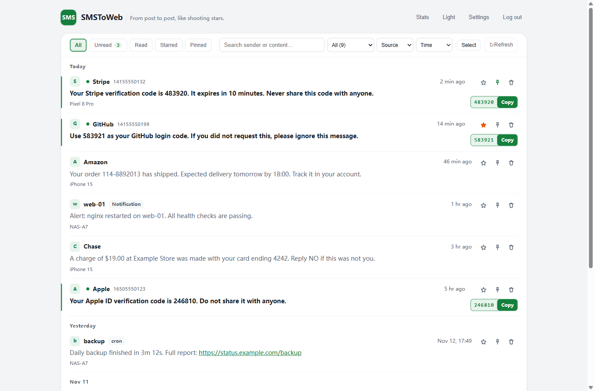
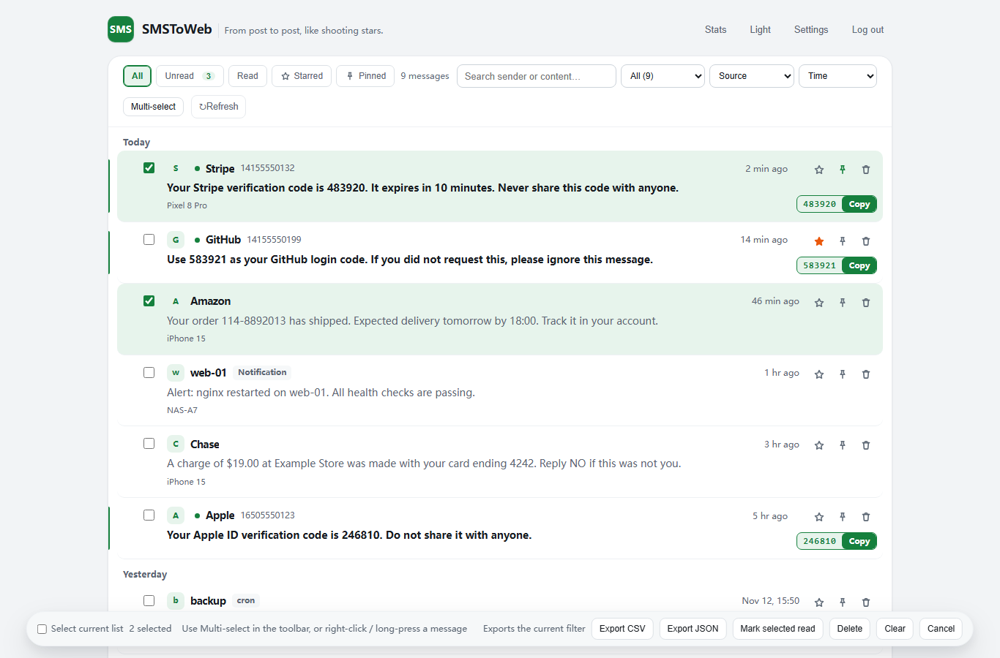
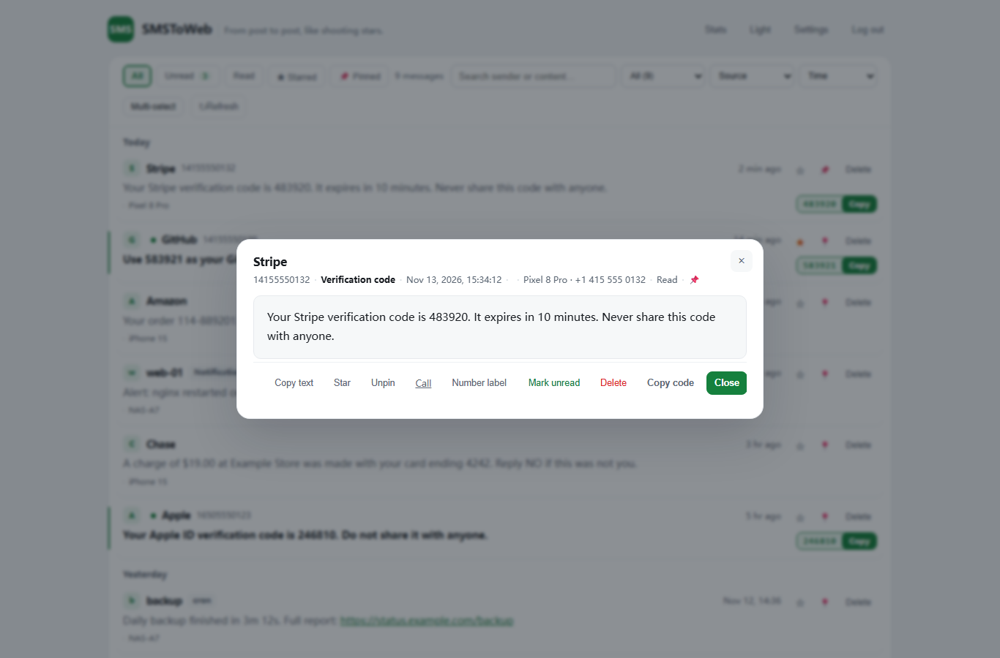
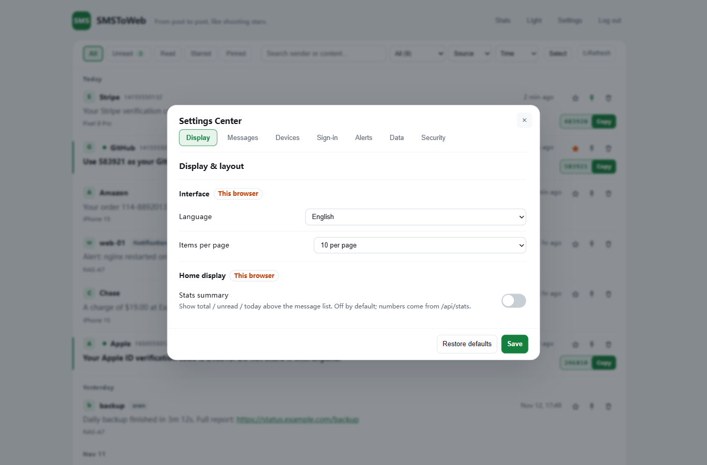
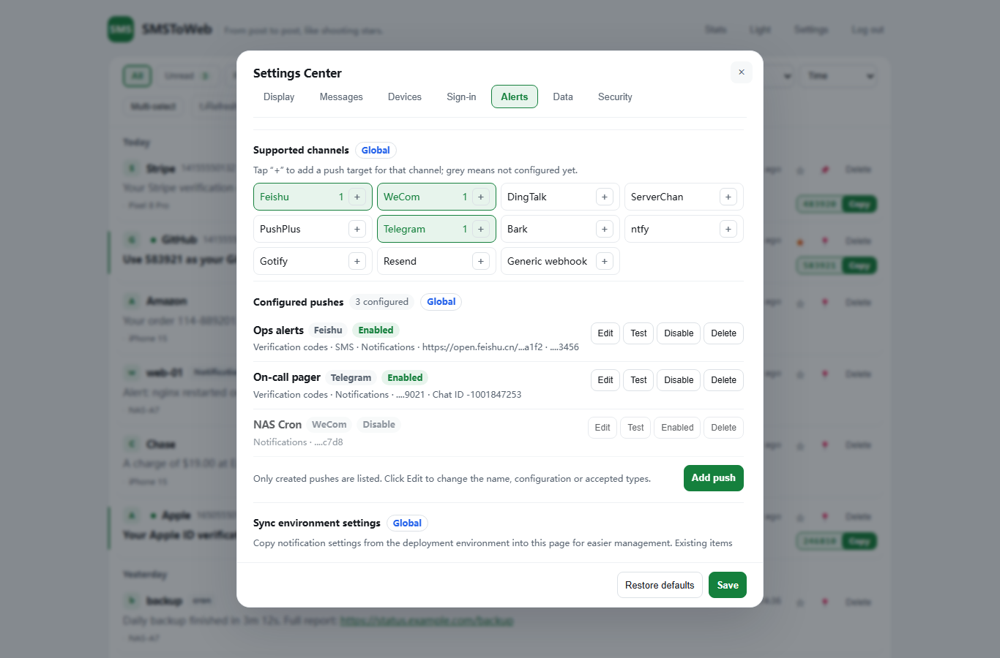
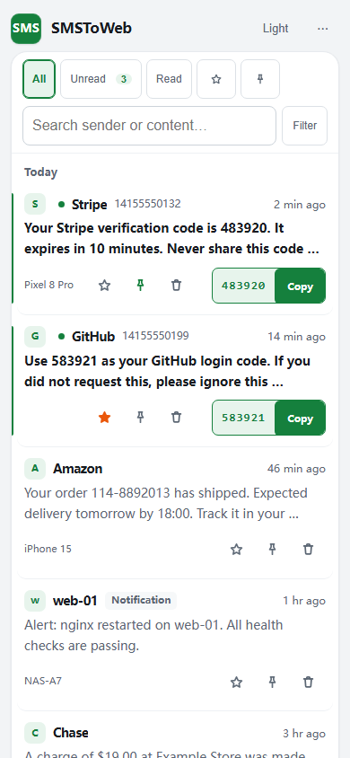

# SMSToWeb — 短信/通知上云网关

[English](../../../README.md) | **简体中文** | [繁體中文](../zh-TW/README.md) | [日本語](../ja/README.md) | [한국어](../ko/README.md) | [Español](../es/README.md) | [Français](../fr/README.md) | [Deutsch](../de/README.md) | [Português (BR)](../pt-BR/README.md)

把来自各渠道的消息（短信转发、应用通知、脚本、Webhook、自定义接入）通过统一的 HTTP 接口与消息格式汇聚到一处，在同一个网页里查看、检索并转发。

- **多平台支持**：Cloudflare Workers / Vercel / Deno Deploy / Netlify / 腾讯 EdgeOne Makers / Docker 自托管，按自己的环境任选合适的平台部署。
- **实时接收**：Webhook 秒级入库，网页自动刷新，无需手动操作
- **通用推送**：任何能发 HTTP 请求的设备（Linux / Windows / macOS / iOS / NAS / 脚本）都能把通知推进同一个页面
- **来源与筛选**：按来源动态筛选（自动聚合短信 / 通知及自定义来源），叠加关键词搜索与今天 / 近 7 天 / 近 30 天时间范围，分页条数可调
- **消息列表**：默认 **10 条/页**；卡片显示两行摘要（最多 120 码位，Unicode 安全），点击打开全文；「加载更多」按游标渐进加载；打开详情自动标记已读，失败会回滚并提示
- **验证码**：服务端识别中文 / 英文 / 中英混合语境（4–8 位、分隔码、字母数字混合，剥离手机号/订单号/金额/日期干扰），卡片顶部右侧显示验证码并支持一键复制；Clipboard 失败时回退 `execCommand`，两者都失败会明确报错，不假报成功
- **多渠道通知**：新消息可自动转发到飞书 / 企微 / 钉钉 / Telegram / Server酱 / PushPlus / Bark / ntfy / Gotify / 邮件 / 自定义 Webhook；每个渠道支持**多个独立目标**，逐目标启停/重命名/删除/测试，单个目标失败不影响其他目标；旧环境变量仍作兼容回退
- **安全可选**：管理页登录开关、多格式验证码识别（码前/码后/分隔式/混合码，防误报）与一键复制、暗色模式
- **数据与提醒**：按当前筛选一键导出 CSV / JSON；页面可见时新消息有 toast / 可选提示音 / 悬浮提醒，后台时浏览器通知 + 标题未读；超长消息自动折叠
- **号码识别**：内置常见机构号码库（运营商 / 银行 / 快递 / 政务等）自动标注；未知手机号可选显示归属地（默认开启，可关）
- **九语言**：管理页与登录页内置简体中文 / 繁體中文 / English / 日本語 / 한국어 / Español / Français / Deutsch / Português (BR)，管理页在**设置中心 → 界面语言**切换（按浏览器保存，`?lang=` 可直连，选择记在本地）；日期、相对时间、号码机构名同步切换
- **移动端友好**：`viewport-fit` 安全区适配刘海屏与手势条、输入框 16px 防 iOS 自动放大、触控目标加大、底部抽屉式弹层、PWA 可添加到主屏幕
- **批量与撤销**：复选框与批量栏默认隐藏，右键/长按消息进入多选；批量已读、删除、按筛选清空、CSV/JSON 导出；删除后 5 秒内可撤销（软删除）；暗色模式支持自动 / 浅色 / 深色三态
- **收藏 / 未读 / 统计**：星标置顶、只看收藏 / 未读、统计面板（来源分布 + 近 7 天）；自定义号码标签；搜索高亮与历史；设置里可配免打扰与提示音；可添加到主屏幕（PWA）

## 界面截图

**消息中心总览**



**按需多选**



**消息详情**



**设置中心**



**通知多目标**



**移动端布局**



```
【短信】Android(SmsForwarder) ──POST /api/receive──┐
                                                   ├─→ 云端网关（任选一平台）─→ 数据库
【通知】各平台脚本/快捷指令 ──POST /api/push────────┘         │
                                                  浏览器 ◀── 网页管理页（网关内嵌）
```

**一键部署到 Cloudflare**：

[](https://deploy.workers.cloudflare.com/?url=https://github.com/ShenDoyle/SMSToWeb/tree/main/platforms/cloudflare)

按钮会克隆公开仓库到你的账号、创建并绑定 D1 等平台资源、配置构建/CI；建表由应用首次请求自动完成，密钥在设置页填写。完整能力矩阵见 [部署能力矩阵](../../guide/10-部署能力矩阵.md)。

| 平台 | 部署方式 | 定时清理 | 详细教程 |
|---|---|---|---|
| **Cloudflare**（推荐） | Worker + D1 | 平台 cron | [platforms/cloudflare/README.md](../../../platforms/cloudflare/README.md) |
| Vercel | Edge Function + Turso | 平台 cron | [platforms/vercel/README.md](../../../platforms/vercel/README.md) |
| Deno Deploy | Deno 原生 + Turso | Deno.cron | [platforms/deno/README.md](../../../platforms/deno/README.md) |
| Netlify | Functions v2 + Turso | Scheduled Function | [platforms/netlify/README.md](../../../platforms/netlify/README.md) |
| 腾讯 EdgeOne Makers | Functions + Turso | 外部 cron | [platforms/edgeone/README.md](../../../platforms/edgeone/README.md) |
| Fly.io / Railway / VPS | Docker（Node 22）+ Turso/本地 SQLite | 进程内置 | [platforms/node/README.md](../../../platforms/node/README.md) |

> 每个平台目录**完全自包含**（代码 + schema + 独立文档，零 npm 依赖、无需构建），点上表「详细教程」即可按步骤部署。功能与数据表结构全平台一致，可随时互相迁移。
> 平台对比与通用准备（Turso 数据库）见 [platforms/README.md](../../../platforms/README.md)。

---

## 手机端与多平台接入

所有平台把消息推进同一个网页：手机短信走 `/api/receive`（安卓 SmsForwarder），其余一切通知走通用接口 `/api/push`。

分步配置（每平台附可直接复制的命令/脚本）：**[docs/多平台接入部署指南.md](../../../docs/多平台接入部署指南.md)**

**通用推送接口速览**（详细字段见接入指南）：

```
POST https://<你的域名>/api/push?token=<RECEIVE_TOKEN>
{"source":"notify","sender":"demo","content":"hello from anywhere"}
```

返回 `{"success":true,...}` 即入库；完全相同的重复推送返回 `duplicated:true`。

## 环境变量（各平台通用）

| 变量 | 必填 | 说明 |
|---|---|---|
| `RECEIVE_TOKEN` | 是 | 推送鉴权密钥，自己编一个足够长的随机字符串 |
| `ENABLE_AUTH` | 否 | `"true"` 管理页需登录（**安全强烈建议开启**，见下方安全建议）；默认免登录 |
| `ADMIN_PASSWORD` | 否 | 登录密码（`ENABLE_AUTH="true"` 时配置；漏配时管理接口一律拒绝访问并告警——配置缺失不放行） |
| `RETENTION_DAYS` | 否 | 数据保留天数，默认 30 |
| `WAIT_MAX_SECONDS` | 否 | 长轮询 `/api/wait` 最长挂起秒数，默认 25（范围 3–25）。部署在 **Netlify Functions**（默认 10s 上限）或其它短超时平台时设成 `8`，避免请求被平台强杀 |
| `PHONE_AREA_ENABLED` / `PHONE_AREA_API` | 否 | 号码归属地：默认开启（360 免费接口、无 key、后端缓存 24h，仅查 11 位手机号）；设 `false` 关闭；自定义源用 `PHONE_AREA_API`（URL 含 `{number}` 占位） |
| 通知渠道变量 | 否 | `FEISHU_WEBHOOK`（飞书）/ `WECOM_WEBHOOK`（企微）/ `DINGTALK_WEBHOOK`（钉钉，可选 `DINGTALK_SECRET` 加签）/ `SERVERCHAN_SENDKEY` / `PUSHPLUS_TOKEN` / `TELEGRAM_BOT_TOKEN`+`TELEGRAM_CHAT_ID` / `BARK_DEVICE_KEY`（可选 `BARK_URL`）/ `NTFY_URL`（可选 `NTFY_TOKEN`）/ `GOTIFY_URL`+`GOTIFY_TOKEN` / `RESEND_API_KEY`+`MAIL_TO`（邮件，可选 `MAIL_FROM`）/ `GENERIC_WEBHOOKS`（通用 Webhook，可选 `GENERIC_WEBHOOK_TEMPLATE` 请求体 / `GENERIC_WEBHOOK_HEADERS` 请求头）。配置哪个转发哪个，全部不配置则不转发；通知按内容自动三态渲染（🔐 验证码 / 💬 短信 / 🔔 通知） |
| `SITE_NAME` / `SITE_ICON` | 否 | 网站名 / 图标 URL，未设置用默认值 |
| `NOTIFY_LINK` | 否 | 管理页首页地址；配置后所有通知渠道附「打开管理页」入口（按钮/链接/click），未配置自动省略 |
| `SESSION_SECRET` | 开启登录时必须 | 登录会话签名密钥：**高熵随机值（建议 ≥32 位随机字符串），与管理密码完全独立**，Cloudflare 与 EdgeOne（及各平台）须分别配置独立值；严禁提交到 Git 或复用密码。缺失时登录与鉴权**安全失败**（登录返回 500、管理接口一律 401，不回退密码派生）。轮换（更换值）后所有旧会话立即失效，需重新登录。会话有效期 30 分钟；退出登录仅清除浏览器 Cookie，已复制的会话 Token 在 TTL 内（最长 30 分钟）仍可能有效 |

Cloudflare 平台额外需要 `DB`（D1 绑定）；其余平台需要 `TURSO_DATABASE_URL` / `TURSO_AUTH_TOKEN`（Turso 数据库，见各平台教程）；Node 自托管另支持 `SQLITE_PATH` 本地 SQLite 模式（见 platforms/node/README.md）。

> **安全强烈建议**
> 1. **开启管理页登录**（`ENABLE_AUTH="true"` + `ADMIN_PASSWORD`）：管理页承载短信验证码等敏感内容，默认免登录意味着知道域名的人都能查看全部消息并删除数据。登录接口已内置限速（同 IP 连续失败 5 次锁定 10 分钟）；`/api/receive`、`/api/push` 另有每 IP 每分钟 120 次的写入限速（超限返回 429）。
> 2. **推送 token 走 URL query 的取舍**：为兼容 SmsForwarder 等客户端，`/api/receive`、`/api/push` 支持 `?token=` 查询参数传鉴权——token 会出现在 URL 中，可能进入平台访问日志、浏览器历史。介意的话请改用 POST + 请求头 `Authorization: Bearer <RECEIVE_TOKEN>` 传递（两种方式都支持）。

## License

[MIT](../../../LICENSE) © 2026 [左立方](https://cbm.im/)
